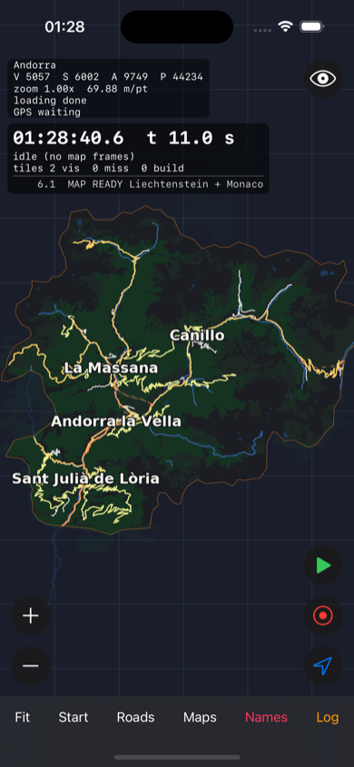
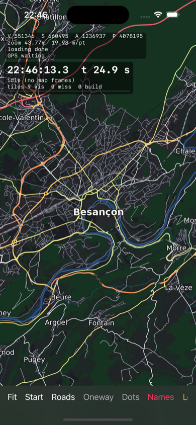
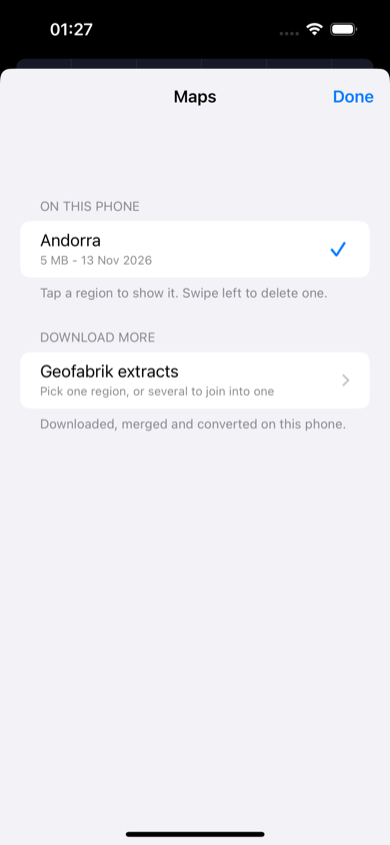
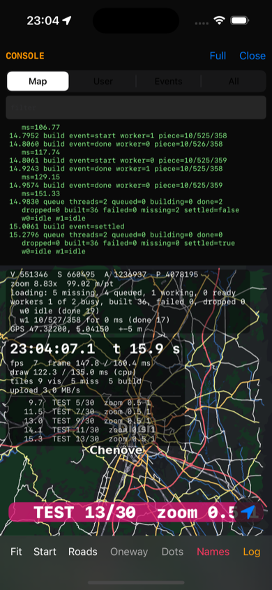

# verst

Offline map and navigation for iPhone and desktop, built from OpenStreetMap data.

verst turns an OpenStreetMap extract (`.osm.pbf`) into memory-mapped files: a car road
graph, plus a map of areas, buildings and lines. It then draws them with one shared C++ / OpenGL
core. The iPhone app needs no map prepared on a PC: it downloads Geofabrik extracts, merges
neighbouring ones and converts them on the phone.

## Screenshots

| Region with border and grid | City detail | Maps screen | Console |
|---|---|---|---|
|  |  |  |  |

iPhone Simulator; the black boxes are the debug info (the eye button hides them).

## Features

- **Maps made on the phone**: pick one or more Geofabrik regions; the app downloads them,
  merges them and converts them. Downloads can be paused, resumed and cancelled, and they survive a restart.
- **Several regions, one shown at a time**: switch between them; each keeps its own camera.
- **Region border**: outside the region, the map is dimmed and covered by a km grid that follows the zoom.
- **Tiled vector map**: roads by class, areas, buildings, water and place names (SDF labels
  placed by priority) are drawn with OpenGL ES 3.0 on iOS and OpenGL 3.3 on desktop.
- **Address search, offline**: house numbers, streets and places, found as you type and
  shown with a pin; the index is built during the same conversion (`search.db`).
- **Routes for car, bike and walking**: hold the map 1 s to drop a pin, then Route (from
  the GPS position or a start pin); a point shared from Google Maps is routed to at once.
  A* over the road graph, which holds car roads, cycleways, footways and paths with the
  travel modes allowed in each direction.
- **GPS**: follow mode and heading-up mode, GPX track replay.
- **Debugging built in**: live console, session log, screen and camera recording with replay.
- **Desktop tools**: `osm2nav`, `pbf_merge`, `navcheck` and the `navview` viewer, over the same
  library the app uses.

Status: map viewer and on-phone pipeline work; routing and turn-by-turn are not started
(see [Known limits](#known-limits) and [docs/challenges](docs/challenges/README.md)).

## Quick start

```sh
git clone --recursive https://github.com/vasiliok/verst.git
cd verst
mkdir -p data && curl -L -o data/andorra.osm.pbf https://download.geofabrik.de/europe/andorra-latest.osm.pbf

cmake -S . -B build && cmake --build build -j
build/osm2nav data/andorra.osm.pbf out/andorra
build/navview out/andorra --center 42.48014 1.45493 --mpp 1.1
```

iPhone app: see [ios/README.md](ios/README.md).

## Repository layout

| Path | What |
|---|---|
| `src/` | shared C++ core, one directory per part (base, geometry, storage, provider, route, search, session, render, convert, tools); see [src/README.md](src/README.md) |
| `ios/` | UIKit front end (map view, Maps screen, downloads, console) |
| `tests/` | GoogleTest unit tests |
| `docs/` | design articles (graph, storage, tiling, shaders, smooth navigation, challenges) |
| `third_party/` | libosmium and protozero (submodules), pre-generated glad GL loader |

## Tools

| Tool | Usage |
|---|---|
| `osm2nav` | `osm2nav <input.osm.pbf> <out_dir>`: road files + `map.dat`; prints counts, time and peak memory |
| `pbf_merge` | `pbf_merge <out.osm.pbf> <in1.osm.pbf> <in2.osm.pbf> ...`: joins neighbouring extracts into one (border objects written once) |
| `navsearch` | `navsearch <out_dir> <text> [<lat> <lon>]`: searches the address index (`search.db`) like the app, prints results and the query time |
| `navroute` | `navroute <out_dir> <lat> <lon> <lat> <lon> [car\|bike\|foot]`: route between two points like the app, prints length, time and search time |
| `navcheck` | `navcheck <out_dir>` (exit 0 = all PASS) - `navcheck <out_dir> --dump-way <osm_way_id>` |
| `navview` | `navview <out_dir> [--center <lat> <lon>] [--mpp <metres>] [--rotate <deg>] [--gpx <file.gpx> [--speed <x>] [--track-time <s>]] [--tile-borders] [--screenshot <file.bmp>]` (screenshot: renders 3 frames, saves the last, exits) |
| iPhone app | `ios/`: UIKit + OpenGL ES 3.0, same map code as navview; download, merge and convert on the phone; see [ios/README.md](ios/README.md) |

## Map pipeline

```
Geofabrik .osm.pbf (+ .poly) --download--> [pbf_merge if several] --osm2nav--> region folder
```

| Step | Code | Notes |
|---|---|---|
| merge | `src/convert/pbf_merge.h` (`merge_pbf`) | streams all sorted inputs at once; small memory whatever the size |
| convert | `src/convert/osm_convert.h` (`convert_osm`) | road graph first and freed, then map layers using only the nodes they need; writes into `<out>.tmp` and renames at the end, so a cancelled run leaves nothing behind |
| progress / cancel | `src/base/convert_progress.h` | phase + fraction, read from any thread; `cancel()` stops between input blocks |
| address search | `src/convert/osm_addresses.h`, `src/search/search_engine.h`, `src/search/search_rank.h` | house numbers, streets and places into `search.db`; the engine (SQLite FTS5 today, `src/search/search_sqlite.cpp` only) is behind two interfaces, so it can be replaced |
| region border | `src/geometry/region_outline.h` | Geofabrik `.poly` -> filled shape + border lines; the renderer dims the outside and draws a km grid there |

The desktop tools are thin `main()` functions around the same `vrst_convert` library that the
app links. The converter sources are built with `-O2` even in Debug, because phone builds
are otherwise `-O0`.

Measured on the Mac: Bourgogne + Franche-Comte (326 MB pbf) peaks at 579 MB.
Ile-de-France (340 MB pbf) takes 41 s and peaks at 483 MiB (V 560,556 - S 696,633 -
3,152,351 buildings).

## Desktop and mobile

One C++ core, thin front ends:

| Layer | Files | Used by |
|---|---|---|
| map provider (client API: extent, places, show / take_ready, status, events) | `src/provider/map_provider.h`, `src/storage/map_piece.h`, `src/storage/map_kinds.h`, `src/geometry/geo.h` | navview, iPhone app, renderer |
| nav map provider (today's implementation: nav files, z/x/y tiles, worker threads) | `src/provider/nav_map_provider.h`, `src/storage/map_tiles.h` | only `open_map()` and tests |
| nav files (mmap, typed views) | `src/storage/format.h`, `src/base/mapped_file.h`, `src/storage/nav_files.h` | osm2nav, navcheck, nav map provider |
| pipeline (merge, convert, progress) | `src/convert/pbf_merge.h`, `src/convert/osm_convert.h`, `src/convert/osm_map_layers.h`, `src/base/convert_progress.h` | osm2nav, pbf_merge, iPhone app |
| region outline (.poly) | `src/geometry/region_outline.h` | renderer, iPhone app |
| map view (class tables, camera, map frame) | `src/provider/map_scene.h` | navview, iPhone app |
| OpenGL renderer (GL 3.3 core / GLES 3.0) | `src/render/tile_renderer.h`, `src/render/map_renderer.h`, `src/render/shaders.h`, `src/render/gl_api.h` | navview, iPhone app |
| desktop front end (GLFW, Dear ImGui, mouse/keys) | `src/tools/navview.cpp` | macOS, Linux, Windows |
| iPhone front end (UIKit, GLKView, gestures, Maps screen, downloads) | `ios/*.mm` | iOS |

New features go into the core first; a front end only adds input and UI.

The front ends and the renderer get map data only through `Vrst_map_provider`
(`open_map(location)`). They never include a storage header (format.h, nav_files.h,
map_tiles.h), so the storage can change (for example to the pre-built tiles of
[docs/storage](docs/storage/README.md)) without touching them. The provider reports its
work for debugging: `status()` (threads, busy workers and how long, queue, missing,
`settled` = everything on screen loaded), `take_events()` (Started, Done, Failed,
Settled) and `describe()` (free text about the data).

## Build

```sh
git submodule update --init      # libosmium + protozero (or clone with: git clone --recursive <repo>)
mkdir -p data && curl -L -o data/andorra.osm.pbf https://download.geofabrik.de/europe/andorra-latest.osm.pbf

cmake -S . -B build                    # Release by default; -DNAV_TEST_PBF=<pbf> to use another file
cmake --build build -j
ctest --test-dir build --output-on-failure   # runs osm2nav + navcheck on NAV_TEST_PBF, and the unit tests
```

Dependencies: zlib (system). GLFW 3.4, Dear ImGui v1.93.0 and FreeType 2.13.3 are fetched with FetchContent; the
DejaVu Sans label fonts are downloaded into `<build>/fonts` at configure time. The glad GL 3.3 core loader is
pre-generated in `third_party/glad/` (no Python needed at configure time; see its README to regenerate).
Use `-DNAV_BUILD_VIEWER=OFF` to build without GLFW/OpenGL.

## Docs

All comments are Doxygen (`///`, `///<`, `@file`, `@return`). All settings are in the
[`Doxyfile`](Doxyfile) at the repo root. Install Doxygen and Graphviz (`brew install doxygen
graphviz`), then either:

```sh
doxygen                               # from the repo root -> ../tmp/verst/doxygen/html/index.html
cmake --build build --target docs     # -> build/docs/html/index.html (adds the generated vrst_types.h)
```

Both also write XML next to `html/` (`xml/index.xml` lists every compound, one `<refid>.xml` per
class, file, namespace and page; schema in `xml/compound.xsd`), for tools that read the API.
Both write every warning to `warnings.log` next to `html/`; the project rule is 0 warnings.
Class, collaboration and include diagrams need Graphviz; without it set `HAVE_DOT = NO`.
The CMake target is skipped when Doxygen is not found.

Articles (also rendered as Doxygen pages):

- [How Vrst_graph works](docs/vrst_graph.md): forward/backward CSR, arc fields, how osm2nav builds it, file layout and costs, and how the nav_files.h classes and file ids link together.
- [Where the data lives](docs/storage/README.md): storage decision (proposal) - binary memory-mapped files for routing and pre-built tiles, SQLite (FTS5 + trigram + R*Tree) for search and user data, and the criteria and benchmark for choosing the storage engine.
- [Architectural bottlenecks & hard engineering challenges](docs/challenges/README.md): the risks on the way from map viewer to turn-by-turn navigation (turn restrictions, contraction hierarchies, map matching, label collisions, maneuvers, offline search, updates).

## Scalar types

<details>
<summary>Show</summary>

All code uses the `Vrst_` scalar aliases (`Vrst_int8`...`Vrst_int64`, `Vrst_uint8`...`Vrst_uint64`, `Vrst_float32`,
`Vrst_float64`, `Vrst_size`). CMake generates them into `<build>/generated/vrst_types.h` from
`src/base/vrst_types.h.in`; set one with e.g. `-DVRST_TYPE_UINT32="unsigned int"`. Each alias is checked for size,
signedness and IEEE 754 at compile time, so a wrong setting fails the build.

</details>

## Viewer controls

<details>
<summary>Show</summary>

drag = pan - wheel = zoom at cursor - `Q`/`E` = rotate - `1`-`9` = toggle motorway, trunk, primary,
secondary, tertiary, unclassified, residential (+living_street), service, ferry - `O` = highlight oneway -
`V` = vertices (red = dead end) - `R` = start view - `F` = fit map - `Esc` = quit. The Dear ImGui panel (top left) has the
same toggles plus dot size and rotation sliders; input over the panel does not move the map.
The viewer starts at `--center <lat> <lon>` with `--mpp` ground metres per screen point (smaller = closer).
Without them it uses the default point 47.322, 5.041 (central Dijon, `kDefaultPoint` in `src/provider/map_scene.h`) at 5 m per point.
If the data does not contain the start point, it starts with the whole map in view. Example, the hairpins of
the CS 600 in Andorra: `navview <out_dir> --center 42.48014 1.45493 --mpp 1.1`. The window title shows counts, FPS, the
lat/lon under the cursor and the zoom.

**Place names.** Cities, towns, villages and hamlets (OSM `place=*` nodes with a name) are labelled with text drawn
from a FreeType signed-distance-field glyph atlas (`src/render/glyph_atlas.h`, DejaVu Sans) with a dark halo. Smaller
places appear only when zoomed in (town < 250, village < 45, hamlet < 9 m per point); labels are placed by
priority and dropped when they would overlap a more important one (`src/render/map_labels.h`). `L` toggles them.

**GPS track replay.** `--gpx <file.gpx>` loads a recorded track (`src/session/gpx_track.h`, shared with the iOS app) and
moves a red marker along it at the recorded times, multiplied by `--speed` (default 1). The track is blue, the
driven part yellow, and the camera follows the marker. `--track-time <s>` starts later in the track; without
`--center` the view starts at the marker. `Space` = play/pause, `C` = follow (a map drag turns it off); the panel
has time and speed sliders. Example: `navview <bourgogne_dir> --gpx drive.gpx --speed 2 --mpp 3`.

</details>

## File format (v4)

<details>
<summary>Show</summary>

Every file: `FileHeader` (64 B) + `SectionEntry[n]` (24 B each) + sections at 64-byte aligned offsets.
Little-endian, offsets and indexes only. All files of one import share `build_id`; the loader
refuses mixed sets. Layout is in `src/storage/format.h`; the loader is `src/storage/nav_files.h`.

| File | Sections |
|---|---|
| `graph.dat` `NAVGRAPH` | `VERTEX_COORD` Coord[V] - `FWD_FIRST_OUT` u32[V+1] - `FWD_ARCS` {head, weight ds, seg\|bit31 reversed}[A] - `BWD_FIRST_IN` u32[V+1] - `BWD_ARCS` {tail, weight, fwd_arc}[A] - `BBOX` {min,max}[1] |
| `edges.dat` `NAVEDGES` | `SEG_ATTR` {length_dm, name_id, ref_id, class, maxspeed, flags}[S] - `SEG_VERTICES` {a,b}[S] - `SEG_OSM_WAY` u64[S] |
| `geom.dat` `NAVGEOM` | `SEG_FIRST_POINT` u32[S+1] - `POINTS` Coord[P] (each range includes both end points) |
| `names.dat` `NAVNAMES` | `STR_OFFSETS` u32[N+1] - `STR_DATA` UTF-8 (id 0 = empty, deduplicated) - `PLACES` Place[L] 20 B (city/town/village/hamlet label: pos, name_id, population, kind; sorted by kind, then population) |
| `map.dat` `NAVMAP` | areas (water, land use, buildings - a building whose min-area rectangle is at most 1.25x its area is stored as that rectangle) with earcut triangles, and lines; built by `src/convert/osm_map_layers.h`, cut into z/x/y tiles at runtime by `src/storage/map_tiles.h` |

Coord = int32 lat/lon in 1e-7 deg. A segment is an undirected road piece between two vertices, stored in
OSM way order (a -> b). Each direction that any travel mode may use is one arc; the top 3 bits of the arc
weight say which modes (car, bike, foot), the bits below are the car time in deciseconds. Car oneways have
one car arc (`kSegOneway`); walkers use both directions. The arc running b -> a has bit31 of its segment set.
Version 3 files (car only, no mode bits) still open; the app routes cars on them.

Additions beyond the original spec:
- `BBOX` section in `graph.dat`: the extent of **all nodes in the source file**. The PBF header bbox is
  not used because Geofabrik extracts contain complete ways that reach outside it.
- `SegFlags::kSegOnewayReverse` (bit 7): set with `kSegOneway` when the allowed direction is b -> a.

</details>

## Andorra (Geofabrik, 3.5 MB)

4,073 kept ways -> V 5,019 - S 5,966 - A 9,657 - P 44,266 - 553.8 km of road. The conversion takes about
55 ms with an 18 MiB peak RSS, and `navcheck` passes every check (32 components; the largest holds 98.7%
of the vertices).

## Known limits

- Car profile is simple: class default speeds, or `maxspeed` (km/h, mph, `FR:*`, `walk`). It ignores
  `maxspeed:forward/backward`, `access:conditional`, `oneway=reversible|alternating` (these are treated as
  two-way) and ferry `duration`.
- Integer `maxspeed` only (`"7.5"` is parsed as 7).
- Roads at the edge of an extract end in dead ends (red dots) where the extract cuts them.
- Float precision: positions are float metres relative to the map center, so the error is about 2 mm at
  25 km from the center. A country-sized extract will need tile-local origins at extreme zoom.
- Vertices are numbered in OSM node id order. Hilbert ordering goes in `number_vertices()` in `osm2nav.cpp`.
- 1 px lines only. No spatial index, routing or turn restrictions yet (`SEG_OSM_WAY` is kept for mapping
  restrictions later).

## License

[MIT](LICENSE)
